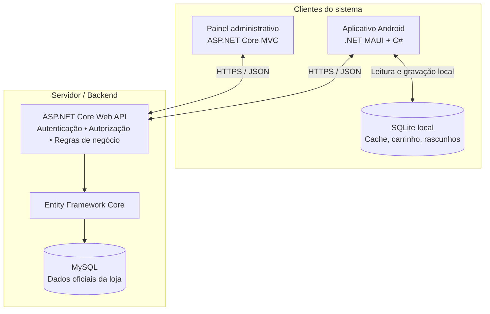
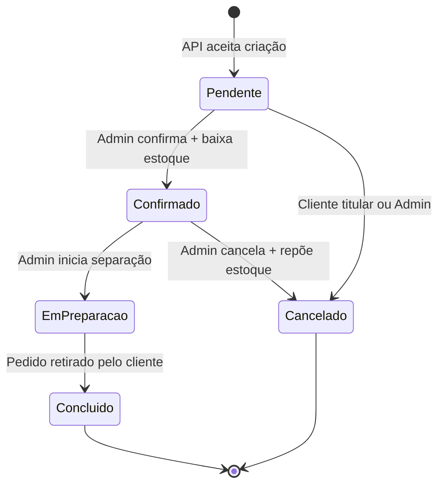
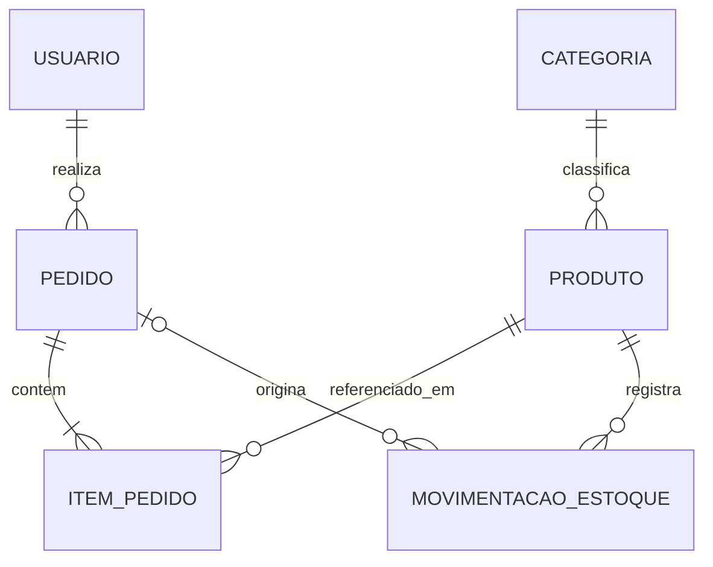

# Loja de Produtos de Limpeza — Requisitos e Arquitetura

> **Projeto acadêmico | Documento de planejamento e referência técnica**  
> **Versão:** 1.0 · **Data:** 08/10/2026 · **Status:** especificação proposta, ainda não implementada  
> **Plataformas do MVP:** Android (mobile), navegador (administração web) e API REST

## 1. Visão geral

A **Loja de Produtos de Limpeza** será um sistema de pedidos com **aplicativo Android para clientes**, **painel administrativo web** e **API REST compartilhada**, permitindo gerenciar catálogo, carrinho, pedidos e estoque.

O aplicativo utilizará **SQLite para armazenamento local**, possibilitando consultar dados previamente sincronizados e salvar rascunhos sem internet. O **MySQL será a fonte oficial** de usuários, produtos, preços, estoque e pedidos; seu acesso será exclusivo da API. O sistema web também deverá consumir a API, sem acessar o MySQL diretamente.

### 1.1 Problema e justificativa

A gestão manual de produtos, pedidos e estoque dificulta o controle de quantidades, a consulta de informações pelo cliente e o acompanhamento de solicitações. A solução busca integrar esses processos e demonstrar, em contexto universitário, a comunicação entre mobile, web, API REST e persistência local/central, com regras de negócio testáveis.

### 1.2 Objetivos

**Objetivo geral:** desenvolver uma solução integrada para pedidos de produtos de limpeza, com administração web, aplicativo mobile e processamento centralizado na API.

**Objetivos específicos:**

1. Disponibilizar cadastro, autenticação e catálogo de produtos no Android.
2. Permitir montagem de carrinho, envio e acompanhamento de pedidos.
3. Manter cache e rascunhos locais com SQLite para funcionamento parcialmente offline.
4. Oferecer administração de produtos, categorias, estoque e pedidos pelo navegador.
5. Centralizar validações, autorizações e regras de negócio na API.
6. Documentar requisitos, arquitetura e testes com evidências verificáveis.

### 1.3 Atores

| Ator | Responsabilidades |
|---|---|
| **Cliente** | Criar conta, autenticar-se, consultar produtos, montar carrinho, enviar e acompanhar pedidos, cancelar os próprios pedidos Pendentes. |
| **Administrador** | Autenticar-se na web; gerenciar catálogo, estoque, clientes (consulta) e pedidos; confirmar ou cancelar pedidos conforme regras. |
| **Sistema/API** | Validar dados, aplicar regras de autorização, persistir pedidos e administrar operações consistentes de estoque. |

## 2. Escopo do MVP

**Incluído:** aplicativo Android; cadastro e login; catálogo e categorias; carrinho; consulta de pedidos; rascunhos offline; envio manual de rascunhos; web administrativa; CRUD de catálogo com exclusão lógica; controle de estoque; confirmação/cancelamento; retirada na loja; API REST; MySQL; SQLite; testes e documentação.

**Fora do MVP:** iOS, pagamento online, cálculo de frete, entregas a domicílio, rastreamento logístico, sincronização automática em segundo plano, relatórios complexos, cupons e notificações push. Esses itens são possibilidades futuras, não compromissos da primeira versão.

## 3. Stack tecnológica

| Camada | Tecnologia | Finalidade |
|---|---|---|
| IDE/editor | Visual Studio Code | Desenvolvimento e depuração, com SDKs, extensões e ferramentas adequadas. |
| Linguagem | C# | Linguagem principal do backend, mobile e web. |
| Mobile | .NET MAUI | Interface e lógica do aplicativo Android. |
| Persistência mobile | SQLite | Cache de catálogo, carrinho e rascunhos locais. |
| Web administrativa | ASP.NET Core MVC, HTML, CSS, JavaScript | Telas administrativas que consomem a API. |
| Backend | ASP.NET Core Web API | Endpoints REST, validação, autorização e regras de negócio. |
| Persistência central | MySQL + Entity Framework Core | Armazenamento oficial e acesso aos dados pela API. |
| Contrato da API | OpenAPI/Swagger | Documentação e testes manuais dos endpoints. |
| Testes automatizados | xUnit (proposta) | Testes unitários e de integração. |
| Versionamento | Git + GitHub | Histórico do código, documentação e colaboração. |
| Apoio ao desenvolvimento | Gemini | Apoio a requisitos, documentação, revisão de código e casos de teste; resultados devem ser verificados. |

**Compatibilidade:** a versão exata do .NET SDK, .NET MAUI, EF Core, provedor MySQL e ferramentas será fixada na etapa de configuração do ambiente. O Android mínimo do MVP será **Android 10 (API 29)**; não significa que essa seja a versão mínima suportada pelo framework.

## 4. Arquitetura da solução



### 4.1 Responsabilidades e limites

- **.NET MAUI:** interface do cliente, navegação, estado do carrinho, cache e rascunhos. Não define preços finais nem confirma pedidos autonomamente.
- **SQLite:** consulta offline e dados locais. Não controla estoque oficial; conteúdo sincronizado pode estar desatualizado.
- **ASP.NET Core MVC:** interface administrativa; deve usar a API para consultar e alterar dados, sem duplicar regras críticas ou acessar o MySQL diretamente.
- **API REST:** autenticação, autorização, validações, cálculo de preços, criação/cancelamento/confirmação de pedidos, atualização do estoque e respostas HTTP padronizadas.
- **MySQL:** origem oficial de dados, com transações e controles para preservar integridade.

### 4.2 Fluxos principais

**Pedido online:** cliente seleciona itens no MAUI → aplicativo solicita criação via API → API valida usuário, itens, produtos ativos, preços e disponibilidade → grava pedido **Pendente** no MySQL → administrador consulta no MVC → solicita confirmação → API revalida e, em transação atômica, confirma e desconta estoque → cliente consulta status atualizado.

**Rascunho offline:** cliente consulta catálogo em cache e monta carrinho → SQLite salva **Rascunho** (estado apenas local) → cliente recupera conexão e aciona **Enviar pedidos salvos** → API revalida preços/produtos/estoque → cliente revisa possíveis alterações antes de registrar → API cria pedido **Pendente** → aplicativo associa o ID oficial ao rascunho.

**Segurança e credenciais:** aplicações cliente nunca se conectam ao MySQL. Fora de ambiente de desenvolvimento, chamadas à API usam HTTPS. Senhas são protegidas com hash seguro; não são salvas no SQLite. Credenciais e tokens sensíveis não são colocados no repositório. Segredos/tokens do aplicativo devem usar armazenamento seguro adequado à plataforma.

## 5. Requisitos funcionais (RF)

Os requisitos RF01–RF15 consolidam a proposta inicial e suas melhorias. RF16–RF19 explicitam capacidades derivadas das decisões D01–D07. Todos dependem de validação pela equipe/professor.

| ID | Requisito | Módulo |
|---|---|---|
| **RF01** | Permitir cadastro e autenticação de clientes no aplicativo. | Mobile / API |
| **RF02** | Listar produtos disponíveis e categorias no aplicativo; disponibilizar consulta correspondente no sistema web. | Mobile / Web / API |
| **RF03** | Permitir adicionar produtos ao carrinho, selecionar quantidades e enviar pedido pelo aplicativo. | Mobile / API |
| **RF04** | Permitir ao cliente consultar exclusivamente seu histórico e status de pedidos. | Mobile / API |
| **RF05** | Exigir autenticação administrativa para acessar o painel web. | Web / API |
| **RF06** | Permitir ao administrador criar, consultar, editar e desativar (exclusão lógica) produtos e categorias. | Web / API |
| **RF07** | Permitir ao administrador consultar os pedidos e alterar seu status conforme regras. | Web / API |
| **RF08** | Disponibilizar atualização do catálogo e categorias do SQLite via API quando houver conexão. | Mobile / API |
| **RF09** | Permitir ao administrador consultar e atualizar quantidades de estoque, com validações. | Web / API |
| **RF10** | Permitir remover itens do carrinho e alterar suas quantidades. | Mobile |
| **RF11** | Calcular e exibir o valor total; o valor oficial deve ser definido pela API. | Mobile / API |
| **RF12** | Impedir ações não autorizadas conforme o perfil do usuário. | API / Web / Mobile |
| **RF13** | Permitir consultar catálogo previamente sincronizado sem internet. | Mobile / SQLite |
| **RF14** | Registrar e preservar data, itens, quantidades, preços aplicados e valor total de cada pedido. | API / MySQL |
| **RF15** | Permitir ao administrador consultar dados de clientes e seus pedidos dentro das permissões atribuídas. | Web / API |
| **RF16** | Permitir cancelamento de pedidos de acordo com status, titularidade e perfil. | Mobile / Web / API |
| **RF17** | Permitir criar rascunhos offline no SQLite e enviá-los manualmente após recuperar conexão. | Mobile / API |
| **RF18** | Permitir ao administrador marcar como Concluído o pedido efetivamente retirado pelo cliente. | Web / API |
| **RF19** | Impedir que o reenvio da mesma tentativa lógica de criação gere pedidos duplicados. | API / Mobile |

## 6. Requisitos não funcionais (RNF)

| ID | Requisito | Verificação / observação |
|---|---|---|
| **RNF01** | Mobile desenvolvido em C#/.NET MAUI. | Projeto MAUI executável em Android. |
| **RNF02** | Administração web desenvolvida em ASP.NET Core MVC. | Aplicação acessível pelo navegador. |
| **RNF03** | API ASP.NET Core Web API documentada por OpenAPI/Swagger. | Contrato e endpoints acessíveis em ambiente de desenvolvimento. |
| **RNF04** | Persistência oficial em MySQL via Entity Framework Core, acessível apenas pela API. | Inspeção arquitetural e testes integrados. |
| **RNF05** | SQLite utilizado como banco local do aplicativo. | Persistência após fechar/reabrir o aplicativo. |
| **RNF06** | Integração dos clientes com a API via requisições HTTPS e payloads JSON em ambientes implantados. | Inspeção de configuração e tráfego. |
| **RNF07** | Usar HTTPS em ambiente de produção/homologação, sem exposição de credenciais. | Verificação do ambiente. |
| **RNF08** | Senhas armazenadas somente como hashes seguros com salt, nunca em texto puro. | Revisão de implementação e testes. |
| **RNF09** | Operações administrativas protegidas por autorização validada na API. | Testes de acesso indevido. |
| **RNF10** | Não persistir senhas nem tokens em texto puro no SQLite. | Inspeção do banco e SecureStorage (quando aplicável). |
| **RNF11** | Erros de comunicação/validação devem ser compreensíveis ao usuário, sem revelar informações sensíveis. | Testes de erros e revisão de respostas. |
| **RNF12** | Definir metas de latência, carga e ambiente de medição antes dos testes de desempenho (D06). | **Pendente**, não atribuir meta arbitrária. |
| **RNF13** | Aplicar controle de acesso a dados pessoais e princípios de minimização e privacidade/LGPD. | Revisão de fluxo e permissões. |
| **RNF14** | Confirmar/cancelar pedidos e alterar estoque sem perda de consistência sob concorrência. | Testes simultâneos com banco transacional. |
| **RNF15** | App Android com versão mínima **Android 10 / API 29** no MVP. | Configuração e testes com dispositivos/emuladores compatíveis. |
| **RNF16** | Tratamento explícito de perda de conexão e dados em cache potencialmente desatualizados. | Testes com rede desligada e restabelecida. |

## 7. Regras de negócio (RN)

| ID | Regra |
|---|---|
| **RN01** | Somente clientes com contas ativas e autenticadas podem registrar pedidos oficiais. |
| **RN02** | Pedido exige pelo menos um item válido e quantidade positiva por item. |
| **RN03** | Disponibilidade de estoque é validada na criação e novamente na confirmação; sem estoque suficiente a confirmação deve falhar. |
| **RN04** | A API calcula e registra o preço oficial dos itens e total; valores locais são estimativas até revalidação. |
| **RN05** | Produtos inativos ou excluídos logicamente não podem entrar em novos pedidos; histórico anterior é preservado. |
| **RN06** | Somente administradores autorizados podem alterar catálogo e quantidades oficiais de estoque. |
| **RN07** | Status oficiais: **Pendente**, **Confirmado**, **Em Preparação**, **Concluído** e **Cancelado**. |
| **RN08** | Fluxo normal: Pendente → Confirmado → Em Preparação → Concluído. Cancelamento somente conforme D03; sem retornos arbitrários. |
| **RN09** | Estoque é deduzido somente na transição Pendente → Confirmado, na **mesma transação atômica** da alteração de status. |
| **RN10** | **Rascunho** é estado exclusivamente local (SQLite); não representa pedido oficial nem reserva estoque. |
| **RN11** | Reenvios da mesma tentativa de criação devem ser idempotentes e não produzir pedidos duplicados. |
| **RN12** | Cancelamento válido de pedido Confirmado repõe o estoque **uma única vez**, na mesma transação de alteração de status. |
| **RN13** | Pedidos Pendentes **não reservam** estoque: podem deixar de ser confirmáveis se o saldo mudar. |
| **RN14** | Cliente cancela apenas seus próprios pedidos Pendentes; administrador pode cancelar Pendentes e Confirmados. |
| **RN15** | Um pedido só passa a **Concluído** após a retirada efetiva na loja; entregas externas não fazem parte do MVP. |
| **RN16** | Uma confirmação sem saldo suficiente não realiza baixa parcial: o pedido continua Pendente e deve informar o motivo ao administrador. |
| **RN17** | Alterações de preço/produto detectadas no envio de rascunho requerem revisão e consentimento do cliente antes do registro. |

### 7.1 Ciclo de vida do pedido



**Observação:** o estado local `Rascunho` **não** integra essa máquina de estados oficial do MySQL. O comando de confirmação deve ser seguro contra cliques/requisições concorrentes; operações de estoque devem usar transações e estratégia de bloqueio ou atualização condicional.

### 7.2 Permissão para cancelar

| Estado atual | Cliente titular | Administrador | Efeito no estoque |
|---|---|---|---|
| Pendente | Sim | Sim | Nenhum |
| Confirmado | Não | Sim | Repõe quantidades uma vez |
| Em Preparação | Não | Não | Não se aplica |
| Concluído | Não | Não | Não se aplica |
| Cancelado | Não | Não | Não se aplica |

## 8. Decisões de arquitetura e produto (D01–D07)

| ID | Definição | Situação |
|---|---|---|
| **D01** | Cliente cria pedido Pendente via mobile; administrador confirma via web; baixa do estoque na confirmação. | Proposta consolidada |
| **D02** | Pedidos Pendentes não reservam estoque. | Proposta consolidada |
| **D03** | Cliente cancela somente seus Pendentes; admin cancela Pendentes ou Confirmados; reposição em cancelamento Confirmado. | Proposta consolidada |
| **D04** | Envio de rascunhos SQLite por ação manual **Enviar pedidos salvos**; sem sincronização automática no MVP. | Proposta consolidada |
| **D05** | Android 10 / API 29 como versão mínima, sem iOS no MVP. | Proposta consolidada |
| **D06** | Indicadores e limites de desempenho serão definidos ao preparar os testes de carga da API/EF Core. | **Pendente** |
| **D07** | Retirada presencial; Concluído somente após entrega ao cliente na loja; sem entrega/rastreamento. | Proposta consolidada |

## 9. Dados e modelagem inicial

### 9.1 MySQL (oficial — entidades previstas)

| Entidade | Principais campos e observações |
|---|---|
| **Usuario** | Id, nome, e-mail único, hash da senha, perfil (Cliente/Administrador), ativo, datas relevantes. |
| **Categoria** | Id, nome, ativo. |
| **Produto** | Id, CategoriaId, nome, descrição, preço decimal, quantidade em estoque, ativo. |
| **Pedido** | Id, UsuarioId, status, criadoEm, confirmadoEm, concluidoEm, total decimal, chave de idempotência. |
| **ItemPedido** | Id, PedidoId, ProdutoId, quantidade, preço unitário aplicado (snapshot), subtotal. |
| **MovimentacaoEstoque** | Id, ProdutoId, PedidoId opcional, tipo, quantidade, data; recomendada para auditoria das baixas e reposições. |

**Restrições essenciais:** chaves primárias/estrangeiras, e-mail único, estoque não negativo, preços e quantidades válidos, chave de idempotência única no escopo do usuário e histórico de itens preservado mesmo após desativação do produto. A modelagem física e o formato da chave serão detalhados na Etapa 2.



### 9.2 SQLite (local — entidades previstas)

| Entidade local | Finalidade |
|---|---|
| **ProdutoCache** | Id oficial, nome, categoria, preço da última sincronização, ativo, data de atualização. |
| **CategoriaCache** | Id oficial, nome, ativo, data de atualização. |
| **ItemCarrinhoLocal** | ProdutoId, quantidade; dados reaproveitados para criação de rascunho. |
| **RascunhoPedido** | Id local (UUID), chave de idempotência persistente, criadoEm, estado local, eventual ID oficial. |
| **ItemRascunho** | RascunhoId, ProdutoId, quantidade; preços do cache são meramente indicativos. |
| **MetadataSincronizacao** | Data da última atualização e/ou versão do catálogo. |

Não armazenar senhas no SQLite. Após envio bem-sucedido, vincular ID oficial e impedir novo envio como se fosse um pedido diferente. Caso haja timeout de resposta, consultar o resultado pela mesma chave idempotente.

## 10. API REST — contrato inicial sugerido

> Rotas ilustrativas: nomes e formatos ainda serão definidos na implementação e publicados em OpenAPI.

| Método | Rota sugerida | Acesso | Finalidade |
|---|---|---|---|
| POST | `/api/auth/registro` | Público | Cadastro de cliente. |
| POST | `/api/auth/login` | Público | Autenticação. |
| GET | `/api/categorias` | Autenticado ou público, a definir | Consulta de categorias. |
| GET | `/api/produtos` | Autenticado ou público, a definir | Consulta de catálogo. |
| POST | `/api/pedidos/validacao` | Cliente | Pré-validação de preços, itens e estoque de rascunho. |
| POST | `/api/pedidos` | Cliente | Criação idempotente de pedido Pendente. |
| GET | `/api/pedidos/meus` | Cliente | Histórico do próprio cliente. |
| POST | `/api/pedidos/{id}/cancelar` | Cliente titular/Admin, por regra | Cancelamento. |
| GET | `/api/admin/pedidos` | Admin | Consulta administrativa de pedidos. |
| POST | `/api/admin/pedidos/{id}/confirmar` | Admin | Confirmação e baixa atômica de estoque. |
| POST | `/api/admin/pedidos/{id}/iniciar-preparacao` | Admin | Mudança para Em Preparação. |
| POST | `/api/admin/pedidos/{id}/concluir` | Admin | Conclusão após retirada. |
| POST/PUT | `/api/admin/produtos` e `/api/admin/produtos/{id}` | Admin | Gerenciamento do catálogo. |
| POST/PUT | `/api/admin/categorias` e `/api/admin/categorias/{id}` | Admin | Gerenciamento de categorias. |
| GET/PATCH | `/api/admin/estoque` (rotas a detalhar) | Admin | Consulta/ajuste de estoque. |
| GET | `/api/admin/clientes` | Admin | Consulta autorizada de clientes. |

**Convenções:** utilizar códigos HTTP coerentes (`200`, `201`, `400`, `401`, `403`, `404`, `409` e `500` quando pertinente), validação de entrada, mensagens seguras, autorização no servidor e documentação dos contratos. O mecanismo de autenticação proposto é JWT na API; o MVC deverá gerenciar sessão e tokens com segurança, sem expô-los desnecessariamente ao navegador.

## 11. Casos de teste planejados

**Situação de todos os testes:** *Não executado*. A aprovação requer execução real e evidência (logs, respostas HTTP, capturas de tela, relatórios automatizados etc.).

| Caso | Cenário | Resultado esperado |
|---|---|---|
| **CT01** | Cadastrar cliente válido. | Conta criada, respeitando validações. |
| **CT02** | Login com senha inválida. | Acesso negado sem vazar detalhes sensíveis. |
| **CT03** | Adicionar e alterar quantidades do carrinho. | Carrinho correto e persistente localmente. |
| **CT04** | Criar pedido online válido. | Pedido oficial `Pendente`, itens e valores registrados. |
| **CT05** | Confirmar pedido com estoque suficiente. | Status `Confirmado`; desconto único e exato de estoque. |
| **CT06** | Confirmar pedido sem estoque. | Confirmação rejeitada; pedido `Pendente`; estoque intacto. |
| **CT07** | Confirmar simultaneamente pedidos concorrentes. | Estoque nunca negativo nem confirmação acima do saldo. |
| **CT08** | Cancelar pedido `Pendente`. | Cancelamento permitido segundo perfil; nenhuma alteração de estoque. |
| **CT09** | Admin cancela pedido `Confirmado`. | Status `Cancelado`; reposição de estoque uma única vez. |
| **CT10** | Cliente cancela pedido `Confirmado`. | Operação bloqueada, sem alteração no pedido/estoque. |
| **CT11** | Desativar produto. | Produto não elegível a novos pedidos; histórico preservado. |
| **CT12** | Consultar catálogo com internet desligada. | Mostrar último cache SQLite e indicar possível desatualização. |
| **CT13** | Criar rascunho offline. | Dados salvos no SQLite sem pedido oficial. |
| **CT14** | Enviar rascunho após recuperar rede. | Revalidação; consentimento se houver preço alterado; novo `Pendente`. |
| **CT15** | Repetir envio por timeout. | Não criar pedido duplicado; recuperar resultado pela chave idempotente. |
| **CT16** | Cliente acessar rota administrativa. | Acesso negado pela API. |
| **CT17** | Marcar retirada/conclusão. | `Concluído` apenas após retirada efetiva, com transição válida. |
| **CT18** | Tentar operação por usuário não titular. | Negar acesso aos dados/pedidos de outro cliente. |

**Formato de registro de cada execução:** ID, requisito/regra associada, objetivo, pré-condições, entradas, passos, resultado esperado, resultado obtido, evidência e situação (Aprovado/Reprovado/Não executado).

## 12. Rastreabilidade resumida

| Área | Requisitos | Regras/decisões | Testes principais |
|---|---|---|---|
| Contas e acesso | RF01, RF05, RF12, RF15 | RN01, RN06 | CT01, CT02, CT16, CT18 |
| Catálogo e carrinho | RF02, RF06, RF10, RF11 | RN02, RN04, RN05 | CT03, CT11 |
| Pedido e estoque | RF03, RF04, RF07, RF09, RF14, RF16, RF18 | RN03, RN07–RN09, RN12–RN16; D01–D03, D07 | CT04–CT10, CT17 |
| Offline e reenvio | RF08, RF13, RF17, RF19 | RN10, RN11, RN17; D04 | CT12–CT15 |
| Plataforma e desempenho | RNF01–RNF16 | D05, D06 | Testes de compatibilidade/carga a definir |

## 13. Organização inicial da solução

```text
loja-produtos-limpeza/
├── README.md                       # Este documento
├── docs/                           # Diagramas, regras detalhadas e evidências
│   ├── requisitos/
│   ├── arquitetura/
│   ├── modelagem/
│   └── testes/
├── src/
│   ├── LojaLimpeza.API/             # ASP.NET Core Web API
│   ├── LojaLimpeza.Web/             # ASP.NET Core MVC
│   └── LojaLimpeza.Mobile/          # .NET MAUI + SQLite
├── tests/
│   ├── LojaLimpeza.UnitTests/
│   └── LojaLimpeza.IntegrationTests/
└── LojaProdutosLimpeza.sln          # Nome/formato final a validar no setup
```

> **Atenção:** os diretórios e projetos de código acima representam a estrutura **planejada**, não arquivos já implementados neste repositório. Não colocar segredos, senhas, arquivos de conexão privados ou bancos de dados pessoais sob versionamento.

## 14. Cronograma de desenvolvimento

| Etapa | Entregável | Critério para avançar |
|---|---|---|
| 1. Planejamento | Requisitos, regras e arquitetura revisados | Aprovação do escopo e fluxos. |
| 2. Modelagem | DER, modelo MySQL, modelo SQLite | Relacionamentos e transações definidos. |
| 3. Ambiente | Ferramentas instaladas, repositório, projetos-base | Execução mínima validada. |
| 4. API + MySQL | Autenticação, CRUD, pedidos, estoque, OpenAPI | Testes por endpoint e integrações. |
| 5. Web MVC | Painel de produtos, estoque e pedidos | Consumo da API e autorizações demonstrados. |
| 6. Mobile + SQLite | Telas, cache, carrinho, rascunhos e envio manual | Demonstração online/offline funcional. |
| 7. Testes integrados | Regressão, concorrência, falhas de rede e segurança | Evidências registradas, defeitos tratados. |
| 8. Entrega | Documentação, código e roteiro de apresentação | Projeto reproduzível e demonstração final. |

**Método de trabalho:** cada funcionalidade deverá passar por implementação, validação e documentação; a Etapa 7 não substitui testes contínuos.

## 15. Riscos e cuidados técnicos

- **Estoque concorrente:** validar e atualizar em transação atômica; impedir saldo negativo e baixa duplicada.
- **Preço/estoque desatualizado no SQLite:** exibir valores como referência, revalidar na API e exigir revisão quando houver mudanças.
- **Falha no retorno do pedido:** usar chave de idempotência persistente e consulta de resultado para evitar duplicação.
- **Cancelamento repetido:** transição única e devolução transacional de estoque.
- **Segurança:** autorizar operações no servidor; usar HTTPS; proteger hashes de senha, tokens e dados pessoais; aplicar princípio do menor privilégio.
- **Compatibilidade de ambiente:** validar ferramentas do .NET MAUI e execução Android no sistema operacional do desenvolvedor; ajustar documentação antes de codificar.
- **Escopo acadêmico:** priorizar jornada completa de pedido com retirada, sem ampliar o MVP com pagamentos ou logística externa.

## 16. Uso de IA Gemini

Gemini será utilizada como **apoio ao desenvolvimento**, especialmente na organização de requisitos, elaboração de cenários de teste, análise de mensagens de erro e revisão crítica de código/documentação. Não integra o funcionamento do aplicativo neste MVP. Sugestões de IA serão verificadas pela equipe; testes e funcionalidades não serão declarados concluídos apenas por terem sido gerados por IA.

## 17. Próximos passos

1. Revisar e aprovar esta especificação com a equipe e o professor.
2. Definir o comportamento de detalhes ainda abertos (incluindo **D06**, contrato definitivo de endpoints e campos de cadastro).
3. Elaborar o DER e os modelos físicos do **MySQL** e **SQLite**.
4. Definir transações de estoque, índice de idempotência e políticas de acesso.
5. Preparar ambiente .NET e criar os projetos, com testes desde os primeiros endpoints.

---

**Legenda:** RF = Requisito Funcional · RNF = Requisito Não Funcional · RN = Regra de Negócio · D = Decisão · CT = Caso de Teste.  
**Estado do documento:** planejamento consolidado a partir das propostas da equipe; ainda não é evidência de software implementado ou testes executados.